<a href="https://magnor.tech"><picture><source media="(prefers-color-scheme: dark)" srcset="assets/banner-dark.svg"></picture></a>

Soy cofundador y COO de **[Magnor](https://magnor.tech)**, una empresa de desarrollo de software con productos propios y proyectos a medida. Llevo proyectos de la idea a producción: requerimientos, arquitectura, desarrollo web y móvil, integraciones y despliegue. Estudio Ingeniería de Sistemas en la Universidad Jorge Tadeo Lozano (8.º semestre) y soy técnico en Electricidad y Electrónica.

**[magnor.tech](https://magnor.tech)** · [LinkedIn](https://www.linkedin.com/in/jesus-pachon-suarez) · [pachonsuarezjesus@gmail.com](mailto:pachonsuarezjesus@gmail.com)

<picture><source media="(prefers-color-scheme: dark)" srcset="assets/impact-dark.svg">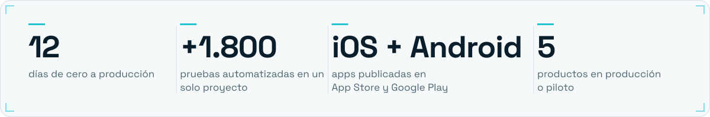</picture>

 

<picture><source media="(prefers-color-scheme: dark)" srcset="assets/section-proyectos-dark.svg"></picture>

<a href="https://github.com/Fircrey/federacion-deportiva-web"><picture><source media="(prefers-color-scheme: dark)" srcset="assets/card-federacion-dark.svg"></picture></a><a href="https://github.com/Fircrey/plataforma-seguridad-b2b"><picture><source media="(prefers-color-scheme: dark)" srcset="assets/card-seguridad-dark.svg"></picture></a><a href="https://github.com/Fircrey/filo"><picture><source media="(prefers-color-scheme: dark)" srcset="assets/card-filo-dark.svg"></picture></a><a href="https://github.com/Fircrey/saas-atencion-ia"><picture><source media="(prefers-color-scheme: dark)" srcset="assets/card-atencion-ia-dark.svg">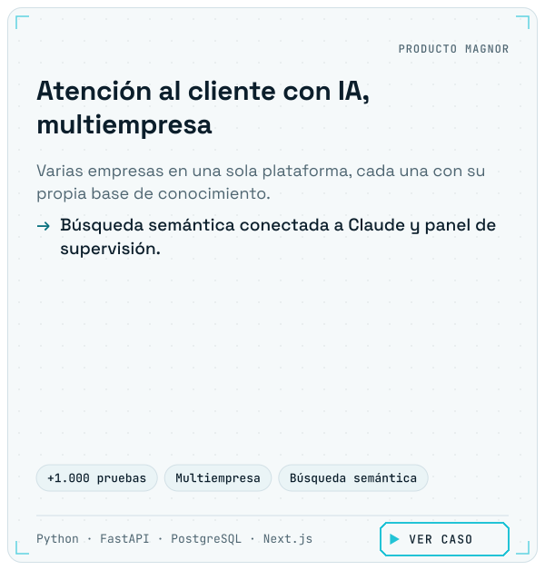</picture></a><a href="https://github.com/Fircrey/magnor-tech"><picture><source media="(prefers-color-scheme: dark)" srcset="assets/card-magnor-dark.svg"></picture></a>

<b>Otros productos de Magnor</b>

 

- **BetWise**: machine learning para inteligencia deportiva. En producción.
- **[FinZen](https://github.com/Magnor-Tech/FINZEN)**: app de finanzas personales. Operativa.

 

<picture><source media="(prefers-color-scheme: dark)" srcset="assets/section-stack-dark.svg"></picture>

<picture><source media="(prefers-color-scheme: dark)" srcset="assets/stack-dark.svg"></picture>

 

<picture><source media="(prefers-color-scheme: dark)" srcset="assets/section-proceso-dark.svg">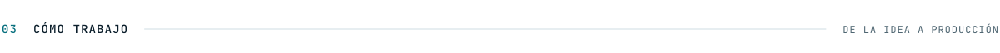</picture>

<picture><source media="(prefers-color-scheme: dark)" srcset="assets/process-dark.svg"></picture>

 

<picture><source media="(prefers-color-scheme: dark)" srcset="assets/section-actividad-dark.svg"></picture>

<picture><source media="(prefers-color-scheme: dark)" srcset="https://raw.githubusercontent.com/Fircrey/Fircrey/output/stats-dark.svg"></picture>

<picture><source media="(prefers-color-scheme: dark)" srcset="https://raw.githubusercontent.com/Fircrey/Fircrey/output/snake-dark.svg"></picture>

 

<a href="mailto:pachonsuarezjesus@gmail.com"><picture><source media="(prefers-color-scheme: dark)" srcset="assets/cta-dark.svg">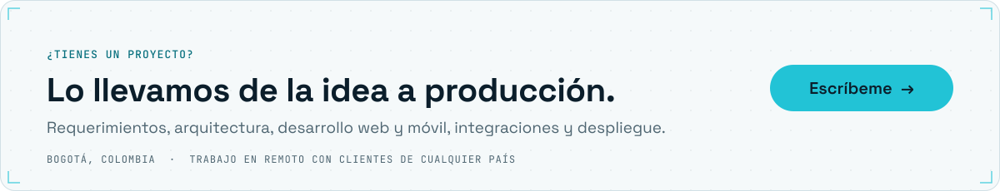</picture></a>

<a href="mailto:pachonsuarezjesus@gmail.com">pachonsuarezjesus@gmail.com</a> · <a href="https://www.linkedin.com/in/jesus-pachon-suarez">LinkedIn</a> · <a href="https://magnor.tech">magnor.tech</a>

